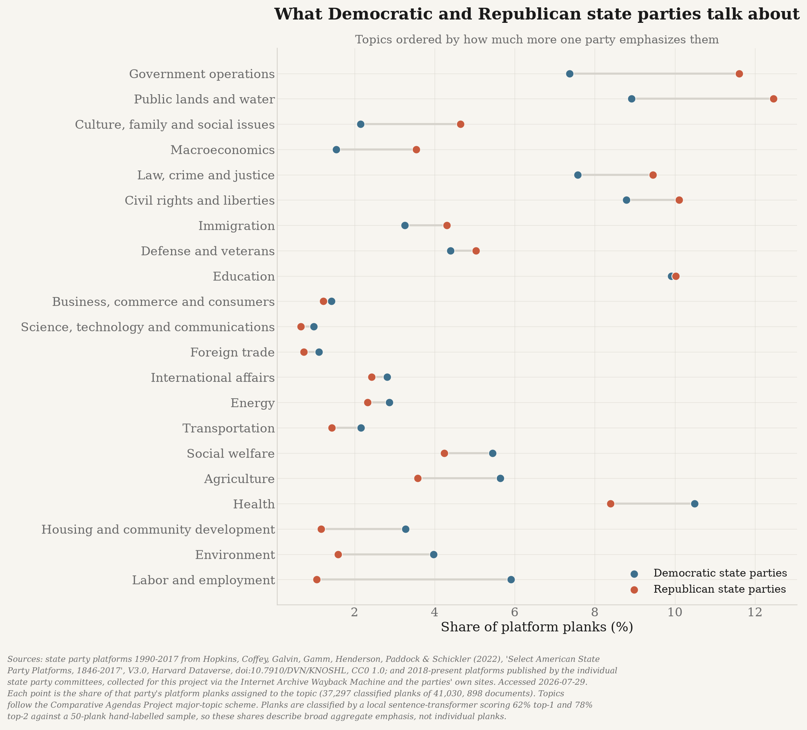

# Methods

Full methodology for [state-politics](../README.md). The README carries the findings and the
caveats a reader needs to interpret them; this document carries the detail needed to check,
extend or dispute them.

**Audit notice (October 18, 2026):** historical collection counts, inferred absences,
classification scores and attribution/validation claims below describe the legacy study,
not revalidated findings. See [AUDIT_STATUS.md](AUDIT_STATUS.md) for the recovered evidence,
source limitations and actual supervised-model diagnostics. The original gold snapshot's
reviewer provenance is unresolved; it is not verified independent human truth.

The complete input-hash, OCR, random-seed and artifact-producer audit is documented separately
in [REPRODUCIBILITY.md](REPRODUCIBILITY.md).

**Contents**

- [Comparison accounting](#comparison-accounting)
- [Stream A: platforms](#stream-a-platforms)
- [Committee-document gaps](#committee-document-observations-and-withdrawn-absence-claims)
- [Stream B: legislators and bills](#stream-b-legislators-and-bills)
- [Classifying both streams into one taxonomy](#classifying-both-streams-into-one-taxonomy)
- [Validating the bill classifier](#validating-the-bill-classifier)
- [Intra-party comparison](#intra-party-comparison)
- [State focus atlas](#state-focus-atlas)
- [Election and voting focus](#election-and-voting-focus)
- [TF-IDF and log2 concentration](#tf-idf-and-log2-concentration)
- [Candidate bill-title reuse](#candidate-bill-title-reuse)
- [Per-state profiles and outliers](#per-state-profiles-and-outliers)
- [Repository layout](#repository-layout)
- [Provenance](#provenance)
- [Figure style](#figure-style)

---

## Comparison accounting

**October 19, 2026 correction:** topic shares are conditional on a classified
sample. An absent topic within an observed party sample is a structural zero;
an absent party sample or an explicitly unknown share is not. Comparisons
preserve unknown shares and leave their gaps unavailable. The topic grid
includes topics observed in any compared stream, retaining source-provided
topic names and rejecting conflicting names for the same code. A topic missing
from every compared source is not fabricated as a new observation.

Equal-state and pooled bill summaries report each party's own observed state
count. The subject-tag replication additionally requires the same states to
have both D/R observations in all three streams: platforms, model-labelled
bills and tag-labelled bills. A missing share in any stream leaves the
replication verdict unavailable. Available ties do not establish the same
nonzero gap direction. Reports separate unavailable rows from available
replication counts; charts leave missing values unplotted rather than drawing
zero-valued markers or calling missing evidence a contradiction.

These production accounting corrections do not revalidate the legacy figures,
counts or agreement claims below. Source completeness, event-time attribution,
classifier certification and analytical regeneration remain separate gates.

---

## Stream A: platforms

The historical corpus (1846-2017) is ingested from Harvard Dataverse. The project's
2018-present source stream is collected from state party websites and the Internet Archive
Wayback Machine. This does not establish that other collections do not exist or that the
project has recovered every available document.

```bash
make historical   # ingest the Dataverse corpus
make registry     # verify all 100 state party websites  (~10 min)
make platforms    # discover + collect 2018-present platforms (~1 h, polite crawl)
```

The collector's `confirmed` field is a **heuristic extraction/discovery flag**, not a
reviewed adoption or operative-version determination. Its filters include a length floor,
declarative policy phrases, state-name checks and binary-response checks. Passing them
does not establish institutional authorship, substantive policy coverage or an operative
date. Legacy notes describe Wayback-first discovery with a live-site fallback and
2.5-second request spacing; their reported retrieval-rate improvement has not been
independently revalidated in this audit.

The collector exhausts every candidate at or above the documented strong-score threshold; it
does not stop after an arbitrary per-organization count. `--resume` preserves successful and
OCR-derived rows, retries failures, and also fetches newly discovered URLs. Partial `--states`
runs merge into the existing corpus rather than replacing unrelated states.

The legacy run reported **1,948/1,948 strong candidate URLs**, 687 heuristic-confirmed
documents and 424 failed retrievals. Those totals are not a reconstructed canonical
contemporary corpus or current coverage certification. The separate retained recovery
inventory and its explicit failures are documented in [AUDIT_STATUS.md](AUDIT_STATUS.md).

The source-only companion keeps original extraction text and separately typed alternatives:
OCR, DOCX main-document text, and PDF native text blocks. Typed recovery inventory v3
adds `pdf_native_blocks` and a distinct-body counter without inflating source-retrieval
counts; v1/v2 inventories remain supported. The source-bound NM-D alternative includes
all 37 physical pages and block coordinates in the complete capture download. Only page
3 was visually checked, which does not certify full-document reading order. Original
bytes/text, Unicode controls, labels and mixed-unit quarantine are preserved. Alternatives
are not admitted to training or analytical results, and the companion remains unpublished.

## Committee-document observations and withdrawn absence claims

The previous claim that 82 organizations had platforms and the other 18 had established
publication gaps is **not revalidated**. Historical or heuristic-confirmed documents
cannot certify current coverage, and failure to retrieve a platform cannot establish
that none is published.

[`conf/platform_gaps.yml`](../conf/platform_gaps.yml) now contains **18 dated observations**,
not 18 verified absences. These include ten qualified legacy July observations and eight
unchanged source-bound reviews. All original probe dates are preserved. The catalogue is
joined into collector reports by `gap_report()` and survives report regeneration; it is
not the complete 100-organization operative-platform ledger.

| Cause | Orgs | Meaning |
|---|---|---|
| `not_confirmed` | 14 | The recorded evidence does not establish an operative platform. |
| `summary_only` | 4 | The reviewed source is a limited statement, not proof that no other platform exists. |

`broken_site` and `client_rendered` remain supported observation types but have no entries
in this catalogue. `no_platform_published` is retired and rejected by the loader, as are
unknown causes. The source-only companion independently leaves **all 100** organizations'
operative-platform statuses unresolved; these catalogue counts are not its coverage totals.

### What bounded searches establish

Legacy notes described archive sweeps, guessed live paths, CMS indexes, alternate domains
and secondary-source links. They did not establish exhaustive source coverage or independent
confirmation of absence. Archive size/path filters, missing captures, access failures,
deferred navigation and untested former hosts can leave substantive evidence undiscovered.
A secondary source's platform link or availability statement is not an independently
verified operative-version determination for the party.

The former assertions that missing platforms were mostly established party-level findings,
that searches had exhausted every archived PDF/HTML page, or that JavaScript-rendered cases
were genuine publication absences are withdrawn. A failed URL is evidence about that
request. A short statement is evidence about that statement. Neither licenses an assertion
about every document the organization publishes. The recovered Alaska platform and other
later source recoveries further require keeping observation, retrieval and adoption separate.

### Supplementing state coverage without relabelling a caucus

The legacy supplement named four legislative-caucus sources:

| State | Caucus source | Year |
|---|---|---:|
| KY | Senate Republican Caucus priority bills | 2024 |
| MD | Senate Democratic Caucus agenda statement | 2026 |
| NJ | Assembly Republican Agenda Center | 2025 |
| PA | Senate Democratic Caucus priorities | 2025 |

These are a different institution and must remain separate from party-committee platforms.
The former 46/50 committee and 50/50 supplemented coverage claims are not current audited
coverage. The canonical `caucus_priorities.parquet` is missing from the latest full artifact
audit; source candidates alone do not establish current agendas or repair the missing
analytical input. Recovered evidence must retain its institutional role and version limitations.

Regenerate the report after editing the findings, without re-crawling anything:

```bash
uv run python -m state_politics.platforms.collect --report-only
```

---

## Stream B: legislators and bills

`state_politics.bills.people` ingests the current legislators for all 50 states from Open
States' per-state CSVs as a **current-membership inventory**, not historical party-at-filing
evidence. Person IDs support source reconciliation, but current labels are not backfilled
onto historical sponsorships.

```bash
uv run python -m state_politics.bills.people
```

**Legacy CSV inventory, not revalidated: 7,359 legislators across all 50 states** — 4,045 Republican,
3,240 Democratic, 74 other. Chambers: 5,389 lower, 1,921 upper, 49 `legislature` (Nebraska's
nonpartisan unicameral). Third parties and independents are deliberately kept as `other`
rather than folded into the major two, since misfiling them would misattribute their bills.

One wrinkle worth naming: New York, Connecticut, Vermont and Oregon permit **fusion voting**,
where one candidate is cross-endorsed by several parties and the source records the combined
ballot lines — `Democratic/Working Families`, `Republican/Conservative/Independence`. Read
literally these match no party and fall to `other`, which stranded 119 legislators (most of
the New York legislature's majority among them). A slash-delimited label naming exactly one
major party now resolves to it; a label naming both stays `other`, because nothing in the
string says which side they caucus with.

`state_politics.bills.openstates_dump` + `bills.ingest` extract the bills themselves from
Open States' public PostgreSQL dump.

```bash
# Requires the retained, provenance-logged snapshot and pg_restore.
# Use a new output directory; existing extractions are never overwritten.
uv run python -m state_politics.bills.ingest \
  --dump data/raw/openstates/2026-10-public.pgdump \
  --out-dir data/processed/bill-rebuild-v2
```

The retained October snapshot contains **1,090,369 source-context measures and 5,028,893
sponsorships** across all 50 states. These are not a certified universe of bills filed
inside the analytical window. Under the date-aware membership rules, only **39 bills are
attributed D and 21 R**; 1,081,990 remain unknown, 8,317 nonpartisan and two other.
The much larger legacy party totals are not current validated attribution.

The retained dump is a PostgreSQL custom-format archive. `pg_restore` streams selected
tables without requiring a restored database. The original snapshot remains on disk with
source provenance; the ingestion command neither downloads a new snapshot nor deletes it.
Other access routes' current availability is not established by this offline audit.

**Session and first-action dates are not interchangeable.** Source-context admission uses
their year overlap so a biennium is not lost solely because it began before 2018.
`session_year`, `first_action_year` and the resolved context `year` remain separate.
That admission rule does not establish exact filing dates or an analytical denominator.
A first action implausibly preceding its session can fall back to the session year for
context, but that fallback cannot date a sponsorship. Historical party resolution uses
only a credible exact first-action date, explicitly labelled `first_action_proxy`.
Missing or contradictory date evidence remains unresolved.

A bill is attributed by its recorded **primary** sponsors. Any unresolved primary sponsor
blocks D/R attribution; resolved cosponsors do not rescue an unresolved primary.
All sponsors are considered only if the source records **no primary sponsors**, and that
fallback is recorded. Nebraska remains outside partisan attribution.

The shared resolver now also returns `party_resolution_reason`, distinguishing missing
person IDs, missing memberships/event dates, undated or malformed memberships, reversed
intervals, inactive/conflicting memberships, active dated membership and nonpartisan scope.
Reasons are mutually exclusive priority outcomes, not an exhaustive list of every possible
uncertainty on a record. The compatibility `party_on_date()` API returns the same party
assignments as before.

The complete **5,028,893-row** diagnostic in
`data/processed/bill-party-attribution-diagnostic-v1/` preserves every original sponsorship
cell and adds only the explicit reason. It reproduces all original party assignments with
zero mismatches; no current-party or legislative-tenure backfill is introduced.
It finds 4,257,879 undated-membership decisions, 640,763 missing person IDs, 119,935
missing event dates, 10,014 nonpartisan rows and just 302 active dated memberships.
These are sponsorship rows, not unique bills. The state/primary breakdown directs further
source recovery, but does not itself supply missing historical affiliations or certify
the recorded date bounds.

### Official Washington session evidence, separately from event-time affiliation

The official Legislature's historical sponsor rosters and detailed bill-version API are
retained in `data/processed/washington-official-legislative-recovery-v1/`, with complete
native XML, service documentation, eight successful provenance receipts and a manifest.
The bounded scope is the five biennia 2017-18 through 2025-26 and the detailed
introduced-since-January-1-2017 response. Its observed coverage is not an assertion
that this date-filtered operation includes all measures.

Reproduce the checksum-bound reconciliation against the retained October baseline:

```bash
.venv/bin/python -m state_politics.bills.washington \
  --out data/processed/washington-official-bill-reconciliation-NEW
```

The producer verifies every retained-source hash and required receipt before writing,
refuses occupied output directories, preserves all 14,143 Washington baseline bill
references, and copies the complete official packet. Zero-substitute/zero-engrossment
originals join only on exact session and bill identifier. Multiple originals are not
silently collapsed. The official prime-sponsor ID then joins the roster on **biennium,
ID and chamber**, never fuzzy name or ID alone. Changing chambers can preserve the
numeric ID while changing the roster row, and some old-chamber rows are blank.

The first reconciliation yields 13,479 unique official matches, 12,735 nonempty legal
titles and 8,773 D / 4,706 R source-scoped session-party observations. The official
short/long descriptions and legal title remain separate from the original title.
They are source-version evidence at retrieval, not certified filing-time full text.
The 658 missing originals, six duplicated-original keys and all 3,979 source-only
originals retain explicit evidence. Source-only rows include appointments and
pre-window measures; they must not simply enlarge the bill denominator.

`session_roster_party` is intentionally not `sponsor_party` or `filing_time_party`.
A roster scoped to a biennium supplies no independently adjudicated event-time party
interval. Every exported filing-time decision remains unknown, canonical inputs remain
unchanged, and both analytical/training admission flags are false. An independent
programmatic XML replay covers every decision/field and exact original-column identity;
it does not constitute independent semantic certification.

The alternate-operation probe packet separately demonstrates why source operations must
remain distinguishable: a missing Senate resolution has a publisher introduction-date
placeholder `0001-01-01T00:00:00` and appears through exact bill lookup, not the bulk
date filter. Sampled missing HB/SB lookups return engrossed rather than original
versions. Neither a placeholder nor an amended version may silently become filing-time
evidence. See the dated counts and manifest identities in [AUDIT_STATUS.md](AUDIT_STATUS.md).

The completed supplemental resolution packet covers all **417** exact missing SR/HR
requests. Reproduce its separate successor without overwriting the original:

```bash
.venv/bin/python -m state_politics.bills.washington \
  --supplementary data/processed/washington-official-resolution-recovery-v1 \
  --supplementary-manifest-sha256 7dc7dc1ab633ee0e5bb7e9b305fa674156349047e3a191953ab91431d2fbff22 \
  --out data/processed/washington-official-bill-reconciliation-NEW
```

The supplement must cover the exact initial missing-resolution population and provide
its own complete manifest, plan, run and receipts. Every returned record must match the
requested biennium, numeric bill number and original chamber. Failures stay explicit,
and amended-only returns do not silently become originals. A successor preserves the
complete initial and supplemental source packets, local XML row positions and a global
record index. It adds **413** original resolutions, for **13,892** unique matches and
**9,034 D / 4,858 R** session-roster observations. All 413 additional introduction dates
are publisher placeholders. Event-time affiliations remain unknown and legal-title
support remains 12,735; raw retrieval success is not equivalent to original-text recovery.

The remaining **251** uncertain measures are queried through the distinct native
`GetSponsors` operation using exact **biennium + original billId**, not `billNumber`.
All source/receipt identities and the exact planned baseline population are frozen.
`parse_records(..., sponsors=True)` preserves ID, name, chamber, explicit Primary/Secondary
type, order and row position. `resolve_native_primary()` resolves every Primary row
against the same biennium/chamber roster. List position, order and resolved cosponsors
are never a primary-party fallback. Conflicting or missing primary evidence remains
unknown. Repeated identical IDs retain all source rows and explicit duplicate counts;
they do not by themselves contradict an otherwise unanimous recorded party.

The native successor adds a distinct `source_session_party` field to a complete ledger,
preserving every previous dictionary cell, original-record ambiguity and unknown
event-time party. Its **1,997** native rows add **161 D / 79 R** observations, giving
**9,195 D / 4,937 R / 11 unknown** across Washington's 14,143 retained measures.
This is not party-at-filing certification, and no canonical input is overwritten.
The ten explicitly titled system-test/training records among the remaining eleven
require non-policy exclusion rather than invented affiliations. The substantive HB 2379
gap is followed through its retained official original HTML/PDF links; its first reading
and printed sponsors are preserved separately from any dated-party or classification
claim. Full source packets, the copied resolver and independent XML replays are indexed
in [AUDIT_STATUS.md](AUDIT_STATUS.md).

### Original document references are candidates, not version truth

The all-state reference inventory is reproducible from the completed October extraction:

```bash
.venv/bin/python -m state_politics.bills.documents inventory \
  --extraction-manifest-sha256 9a3555e5194ac3d45ab30c4107df4f720ad40f3ce85e040fa5336138d8ee8a29 \
  --out data/processed/bill-document-reference-inventory-NEW
```

Every source version and link is retained, including later/unclassified notes and duplicate
URLs. Bill/version identity conflicts fail explicitly; missing version metadata and unlinked
versions remain visible. Source URL strings are never rewritten. Schema 2 adds a separately
labelled `request_url` when whitespace needs percent-encoding; controls, malformed hosts and
unsupported schemes remain unresolved. Syntactic usability is not a network or document check.
An imported original-note hint never certifies native version identity.
Plural "Amendments" and explicit "Final Version" notes are later-version hints too;
word boundaries avoid treating unrelated longer tokens as these labels. The v3 successor
preserves all v2 source fields and request/eligibility decisions, changing only these hints
and their derived counts. The separate reconciliation retains every changed link identity.

Florida's numbered native notes require a state-specific, chamber/number-matched rule:
`H 77 Filed` is an original-note hint only for Florida `HB 77`, not `SB 77`, another
number or another state. Padding, case and note whitespace are normalized without
changing the source strings. The observed `c1`-`c4`, `e1`-`e3` and `er` suffixes
are later-note hints under the same identity guard; retained native samples print
committee-substitute, engrossed and enrolled headers respectively. Proposed-bill
`pb`, unreviewed codes and ambiguous suffix combinations remain unclassified.
Literal amendment/final-version detection retains precedence. Inventory v4 preserves
every v3 source/reference/URL/eligibility/admission field and all non-Florida hints,
changing only the scoped hints and their derived counts.

The four missing filed references in the linked modern Florida external-reference
cohort were recovered from retained official overview links and complete PDFs with
matching native Senate/session/number headers. Their absence from the imported
version-link table was not evidence that the originals did not exist. This supplies
reference coverage, not complete cohort document retrieval, annotation provenance,
filing-time text certification or permission to promote external codes to gold labels.

The `collect` subcommand requires an inventory manifest checksum, explicit `--link-id`
selection and a new `--out`. It retains complete response bytes and physical JSONL receipts,
paces requests, records failed HTTP requests and explicit HTTPS alternatives, skips reviewed
publisher tests without dropping their source records, and returns nonzero for unresolved
or quarantined selected links. Captures remain research-only: HTTP 200 can return an application shell
instead of bill text, and a genuine PDF may be an amendment or automatic comparison.
Native format/version and semantic review remain separate from retrieval.

`bills/florida.py::extract_filed_document` separately extracts complete retained Florida
regular-session HB/SB responses. Every PDF physical page survives, including explicit
unreadable-page dispositions; every HTML bill pre block retains full text and exact
added/deleted character spans. Nested or unbalanced markup is flagged rather than
silently treated as clean text. Anchored native header lines and matching original
print codes are required for a positive observation, not a body citation or a Filed
URL alone. The literal observed Senate `(NP)` marker and leading House U+F020 character
remain in source text; other unknown prefixes/suffixes are not guessed away.
Source-context conflicts and missing/unknown prints never receive scientific admission.

The observed Senate `(Corrected Copy)` marker is retained explicitly as `copy_note`,
not removed as harmless decoration. A matching chamber/session/number and `__` print
code under that marker do **not** establish an uncorrected original: the original-print
observation stays false and `corrected_copy_not_uncorrected_original` remains an issue.
The linked cohort's 2019 SB186 is such a case. Complete accounting can replay its
identity and full text while retaining that negative disposition; it must not turn
the correction into certified initial-filing evidence to make collection checks pass.

Extraction campaigns bind actual source-attempt names, exact planned candidate rows,
response receipts and parser/runner hashes. Root manifests include completed child
manifests; interrupted extraction directories are retained and a new attempt is used.
Unresolved or quarantined responses remain visible and produce nonzero final status.
Independent replay reconstructs complete pre text/markup and all PDF pages, checks
every PDF page's native identity with a second decoder, and verifies saved source
offsets without calling the producer's parsing helpers. Decoder reproduction is not
semantic review, legal/version adjudication or filing-time certification. A bounded
replay names its exact completed batch count; it does not claim the full campaign or
the national bill population has complete text. No canonical classifier input, label
or analytical admission is changed by these research extractions.

The complete linked Florida cohort now accounts for 2,864 imported links and four
separately recovered originals, not every Florida bill or every external-reference
row. Its unlabelled candidate-input inventory joins every complete page/pre unit with
an explicit two-newline separator and exact source-unit offsets. It retains translated
HTML addition/deletion offsets, including deleted words, and never prepends current
titles, summaries or another version's text. The corrected-copy issue travels with
its candidate. PDF strikeouts are not decoded or silently interpreted.

The pinned English ModernBERT tokenizer plans overlapping, section-aware windows under
the saved 1,024-token research policy, with 1,018 source tokens after marker/wrapper
allowances. Every one of 11,472,022 source tokens is covered; no model forward pass
occurs. Independent replay reconstructs full input strings and markup from native
records, retokenizes them and checks every window/offset, overlap and maximum length
without producer input/chunk helpers. Tokenizer warnings about full strings exceeding
8,192 tokens are not inference on overlong sequences: only bounded windows are planned.
Full coverage does not certify a coherent single-topic unit, resolve deleted-text
semantics, authorize labels, or prove classification improvement.

Collection report schema 2 separately records `quarantined_link_ids`. Its small reviewed
conflict registry matches **both the exact source bill ID and response SHA-256**, not a
bill number, URL or document hash alone. Complete bytes remain retained, and each matching
receipt records `native_context_status` and the supporting native-review manifest hash.
This prevents two verified regular-session finals from passing unnoticed under their
New Mexico special-session bill contexts. The same PDF under its legitimate regular-session
bill, or changed bytes after a publisher correction, remains **unreviewed**, not automatically
certified or globally blocked. Older captures are not retroactively described as guarded.

Application shells require native-source tracing rather than guessed PDF/session rewrites.
The bounded SD/WY successor retains publisher client chunks, configuration, complete API
responses, request receipts and every recovered version. SD HB 1132 demonstrates that
a faithfully imported current title can describe a later extensively amended subject,
not the introduced policy. Preserve version-specific text and the original summary title
separately. Wyoming's native Senate record explicitly links a House mirror and its veto
material: related-bill evidence must keep the House identity, not become Senate bill text.
A filename/chamber mismatch alone does not prove an erroneous source attachment.
Session sponsor observations, successful downloads and complete page extraction do not
establish event-time affiliation, enacted status or independent semantic certification.

The South Dakota universe resolver accepts explicit native session objects and complete
bill-response arrays keyed by their native `SessionId`, returning baseline coverage, all
native records and source-only native records separately. It uses native `Year` as the
session identifier and validates `BillType`, `BillNumberOnly`, `BillNumber` and response
year together. An introduction timestamp does not select the session: some 2021 impeachment
session measures have 2022 observations, and regular-session prefilings can occur in the
preceding calendar year. Missing responses fail explicitly; empty successful arrays remain
visible without certifying publisher absence. Repeated keys or reused native IDs remain
ambiguous rather than selecting the first row. Original nested source JSON and physical
response-row positions survive alongside normalized identity fields.

Native-list equality is not denominator certification. In the bounded 2018-2026 SD
reconciliation, four source-only native rows coexist with two baseline identifiers that
cite the same native HJR 5001 overview. One baseline identity supplies document links while
the other supplies action/vote metadata. Retain both source rows and their references for
review; do not treat raw row-count differences as a count of missing analytical bills or
automatically combine their parties, actions, versions or outcomes.

Native SD sponsorship inventory preserves both original `Sponsors` and `PrimeSponsors`
arrays, their field names, every position and the complete source JSON. They overlap and
must not be summed as disjoint sponsorships. Match a source session-member ID only to
the same requested and response session; retain every match and any ambiguity. All native
primaries remain, including opposite-chamber primaries. A unanimous known-party roster
observation is distinct from mixed, unresolved and institutional observations and is
never a certified filing-time party. No first sponsor, majority party, current affiliation
or committee-to-person fallback supplies missing evidence.

If only another session's member record matches the source ID, preserve that relationship
without rewriting the original ID or exact-session party field. An exact joint `PersonId`
and `MemberId` bridge to the requested session is a separately retained identity observation,
not a silent replacement. Keep source/target chamber, party and inactivation fields
separate; chamber changes make old-session substitution particularly unsafe. `InactiveDate`
is not treated as a dated party-membership interval. Independently replay raw rosters and
all source-array positions before indexing a completed research inventory. Raw roster
contact fields remain local and are not approved for companion exports.

Native version-list recovery follows the publisher's bill-ID-bound versions endpoint for
every native bill, retaining all introduced, engrossed and enrolled records. A separate
response replay checks complete raw JSON, source context, physical row positions, optional
date observations and hashes. `plan_introduced_documents()` retains every native bill and
selects a request only when exactly one native note is explicitly `Introduced`. Repeated
introduced rows stay ambiguous even if they repeat the same document ID. Missing originals
do not fall back to a later version or the first API row. The request URL uses the retained
publisher client's document-ID construction, not an invented bill-number/session path.
All candidates remain uncertified until actual bytes and native context are reviewed.

Comparing imported reference IDs with these native version lists does not settle all
document categories. An exact parsed bill/document relationship is a metadata observation,
not retrieval or semantic validation. A legacy URL without a parsed document ID, or a
document absent from this endpoint, remains unresolved rather than being declared a wrong
attachment or nonexistent document.

Keep native amendments separate from bill-version candidates even when the publisher's
amendment record contains `BillVersion: Introduced`. In the retained 2021 SD HB1059 example,
amendment 1059A is document 213785, while the bill's introduced version is document 211321.
The original amendment field is a verbatim observation, not an inferred amendment-stage
or document-role certification. Only the bill-ID-bound **versions** response supplies the
`native_version_note` input to introduced-document planning; amendment metadata uses its
own category and observation columns. A field value shared across endpoints is not proof
that the documents have the same role.

Complete-cohort category reconciliation independently replays amendment arrays, including
successful empty responses, and preserves both raw fields and physical/global source order.
Document ownership is indexed separately for native bill versions, amendments and positive
instruction-document observations. The successor adds category-specific relationships to
the complete original reference table without replacing its fields or earlier decisions.
Exact bill-context matches, unresolved source identities, cross-context matches, unparsed
URLs, absent IDs and any multi-category ownership remain distinct. API absence is not a
failed download; an exact metadata match is not a certified PDF or policy label. The frozen
SD replay resolves all 1,933 formerly unlisted parsed references to amendment metadata under
their exact bill contexts, while leaving the 3,950 unparsed legacy links and HJR split
explicit. The introduced-document plan is not expanded using amendment version observations.

Introduced-document capture retains the exact PDF bytes and both readers' complete strings
for every physical page, not only a prefix or the first page. Independent replay verifies
bytes, receipts, source context, physical page positions and both exact extractions. Empty
pages remain explicit; nonempty text alone cannot establish faithful visible-text extraction.
Header triage uses only the separately retained first-page strings and does not certify the
remaining document's contents.

`parse_document_headers()` recognizes explicit modern and legacy SD publisher layouts,
retaining every occurrence, exact source text and Unicode character offsets. Literal
special-session suffixes remain part of the session observation, and resolution-of-
disapproval identifiers remain distinct from ordinary resolutions. Duplicate headings stay
multiple observations. Missing printed years stay null rather than being reconstructed
from ordinal session titles, API context or introduction dates. The complete-cohort
successor preserves the original narrow-parser results and compares each reader's unique
observations against the full native session key and measure identifier. Its one blank
printed-year finding has a source-bound, visually inspected header crop; the native API
year is a separate observation. No match confers version, filing-time, policy or party
certification, training admission or analytical admission.

All-page embedded extraction can also silently omit visible text. For NM 2026 HB 99's
23-page amendments-in-context PDF, both pypdf and MuPDF extracted only a 61-character
session heading. Rendered pages visibly contained policy text; pinned Tesseract 5.5.2
at 200 DPI recovered 33,501 characters across all 23 pages in a separate immutable
packet. That packet preserves every raster, per-page OCR, original PDF, earlier deficient
text and runtime hashes. Only rendered pages 1, 2 and 23 received visual inspection;
the OCR is not independently corrected. Native committee-substitute identity and the
publisher's proposed/not-yet-adopted-amendment disclaimer remain explicit. Plain OCR loses
color, strikeouts and underscores and must not stand in for adjudicated operative text.

For example, an explicit reference already exercised in the eight-state capture can be
collected into a new immutable output directory:

```bash
.venv/bin/python -m state_politics.bills.documents collect \
  --inventory data/processed/bill-document-reference-inventory-v2 \
  --inventory-manifest-sha256 cd6e133bbcf380d0ea4a775f866c1152b1d27242584a58cc0245672c1308e648 \
  --link-id 949a408a-29d6-44bf-b094-9ab37d50d95c \
  --out data/processed/bill-document-selected-capture-NEW
```

The bounded Washington recovery follows actual retained version-link URLs, not guessed
bill-document paths. Its initial original-note filter accepts Bill, Resolution, Joint
Memorial, Joint Resolution and Concurrent Resolution. All matching version/link rows,
baseline identities and failed requests are preserved; an HTTP failure can trigger an
explicitly recorded HTTPS alternative, never a silent URL rewrite.

Native cover identity and session support are checked separately from imported notes.
Resolution-specific formatting can require an explicit source-scope review rather than
an ordinary bill-cover regex. Reviews add sidecar decisions without changing earlier
automated unknowns. A publisher's biennium path is weaker evidence than a dated cover
and is labelled accordingly; quoted or struck prior years are not event metadata.

Exhausting original-note references does not establish absence of an original document.
Following the remaining 2019-2020 SR 8601 references exposed a plain native resolution
heading beneath an imported Substitute Resolution note, alongside a genuinely
engrossed-heading version. Both complete bodies and the note/header disagreement remain
separate. Their different added rules-heading years also demonstrate why later-version
text must not silently substitute for filing-time evidence. The plain heading alone
does not certify earliest-version identity, and source notes remain unchanged.

HTML is strictly decoded; PDF text is extracted from every page with page boundaries
retained. Plain text loses legislative underline/deletion styling even when extraction
succeeds. Raw native HTML/PDF and complete derived texts are therefore retained together,
with explicit styling-loss and review limitations. These files are not automatically
classifier inputs, independent semantic gold or certified filing-time text. Counts of
parallel HTML/PDF captures, pages and characters are not unique-bill or policy-volume
denominators. This recovery neither changes the original metadata API's ambiguities nor
certifies all-state full-text coverage.

Native universe reconciliation must also precede interpreting missing document URLs.
Montana's official 2024 drafting manual distinguishes an LC drafting-request number
from the House/Senate identity assigned at introduction. Its native API publishes both
identities on one record. Consequently, LC rows cannot be treated as additional formal
filings merely because an imported source labels them `bill`, nor can every LC row be
declared unintroduced. The retained four-cohort reconciliation preserves all 18,403
baseline rows and 15,830 native objects, including 4,585 LC/formal baseline aliases.
Its 7,641 no-URL LC rows comprise 7,488 native null-formal observations, 152 native
formal matches and one unresolved identity. These categories are not interchangeable
text-collection failures.

Native pagination is replayed against response metadata rather than inferred from
the client implementation. For both Montana API families, `offset` denotes a page
index; row-offset-style enumeration can return empty pages while omitting most of the
population. Every declared page, raw object, explicit cohort, request body and hash
is retained, with an independent source/alias replay. Four unmatched source identities
remain unresolved in the initial sidecar. That sidecar did not change filing denominators
or evaluation groups; event-time text/party evidence and historical formal-identity
continuity remain unverified. No source alias is silently merged or admitted to
training/analysis.

The print-identity follow-up makes the historical limitation concrete: retained
2025 Senate prints identify SB6 and SB85, whereas their LC-linked current native
records identify HB117 and HB161. Separate House prints and unnumbered drafts survive
as distinct evidence. Printed headers are retained with exact source spans, year,
LC/formal kind and printed revision, not replaced with current metadata. They establish
what a document prints, not when it was introduced or whether two formal records may
be merged. Both readers reproduce every physical page, including two SB85 documents
with identical complete extracted text but different byte hashes. Source version/link
rows and both responses remain intact. HTTP-200 application shells are not substantive
bill evidence; explicit 404s remain failures. Neither shared LC/title evidence nor a
complete current API traversal proves a complete historical filing universe.

The separately retained official *History and Final Status* volumes for regular sessions
2019, 2021, 2023 and 2025 supply another source family, not automatic historical
adjudication. Every physical page is retained and decoded separately through pypdf and
PyMuPDF. Detailed `INTRODUCED BY` headers, their LC/introducer/drafter observations,
the explicitly bounded primary-sponsor/requesting-entity index, and the six introduced
tallies are separate tables with exact reader-text spans. A sponsor/requestor-index
mention is not a detailed action history; a reported count is not a list of identities.
No printed MM/DD action, cover date or name is silently promoted to a filing date,
operative-version determination or event-time party label.

These distinctions expose actual disagreements within the published source. The 2019
volume reports 1,309 introductions and its sponsor/requestor index identifies all 1,309
native formal keys, but detailed headers cover only 1,298: HJ57–HJ66 and SJ33 are absent
from that detailed census in both readers. The 2021 detailed census covers all 1,313
native formal keys, while its sponsor/requestor index lacks HB132, HB133, HB194, HB214
and HB233. The 2023 and 2025 detailed/index censuses match their 1,698 and 1,759 native
formal keys. Absent detailed entries or index mentions do not establish non-introduction.
The source's own tallies reconcile with all 6,079 current native formal identities;
the 6,068 detailed headers are a distinct, smaller evidence population.

Literal source formats remain visible. `BY:` is accepted alongside `BY`, and the 2021
HB538 header's printed `LC29-1-1` survives verbatim with an explicit unknown normalized
draft identity, not a guessed correction or a discarded formal entry. Numeric LC
comparison removes padding only after validating the identifier; original strings
and reader differences survive. The first census diagnostic is frozen, including its
omitted format cases and faulty padding comparison; a separate corrected successor
and independent complete replay supersede those structured observations.

Exact history joins preserve all 18,403 imported source contexts and every native formal
key. The original four exact-key nonmatches remain unresolved: absence of 2025 SB6/SB85
and 2023 SR55 from the detailed/index censuses does not adjudicate contrary printed
Senate documents or authorize merging them with House/SJ records. The volume does not
classify 2021 LC3368 as a publisher test. Complete decoder/span/join replay establishes
what was retained and reconstructed, not independent semantic or scientific truth.

Native introduction-event observations are a separate source contract. All retained
archive `billActions` and current `draft.billStatuses` are examined at their original
positions. Only matching typed code/name pairs `500` / `(H) Introduced` and `100` /
`(S) Introduced` qualify; code 29 text availability, pre-introduction letters and
draft-request activity do not. Original event JSON, timestamps and current status
record IDs survive. The native timestamp's literal calendar date is observed without
timezone conversion or substitution of the session/cover year.

Originating-chamber identity is explicit: an `(S) Introduced` event on a current House
record cannot date that House filing. All opposite-chamber events remain retained.
One valid originating event supplies a date observation; missing events, invalid
timestamps and multiple originating events remain separate unresolved states. Distinct
status IDs milliseconds apart are not silently collapsed or resolved by taking the
minimum. No first/latest action, document timestamp or printed MM/DD fallback fills a
missing date. A native record lacking a formal identity does not become a formal filing
merely because an event resembles introduction.

The complete native-event sidecar preserves all 15,830 native and 18,403 original
source contexts, including their original dates, parties and LC/formal aliases.
Source-context joins use the existing exact session/identifier reconciliation, not
title similarity or guessed historical continuity. A linked LC context is not another
formal filing. Literal-calendar comparisons are limited to exact formal contexts with
unique valid native observations and available source dates; missing or ambiguous
dates produce no comparison, not a false mismatch. Such comparisons are descriptive:
imported first actions may represent earlier drafting activity and source timezone
conventions differ. Neither agreement nor disagreement certifies filing eligibility
or event-time party. The first null-guard diagnostic and its seven false comparisons
remain frozen separately from the corrected successor and independent full replay.

A separate complete-volume cross-check retains every printed standalone `INTRODUCED`
action and its exact reader/page span, bounded by the active detailed formal header.
The introduced-tally heading on each volume's ninth page is retained as frontmatter,
not counted as a bill action. Bare and explicitly chamber-labelled actions remain
distinct: the three older volumes omit action chambers, as do 119 actions in 2025.
Unprinted chambers remain null rather than inheriting the formal header's chamber.
Dates are literal month/day observations with no year inference or date carry from
another action. Compatible native positions remain a list; repeated actions are not
arbitrarily paired with one of multiple native events.

The 6,061 unique comparable printed/native contexts agree on month/day under both
readers. This does not validate an unprinted calendar year, prove filing eligibility,
or make the publisher's two potentially related source families independent factual
witnesses. The printed histories reproduce the two missing and five repeated 2025
native origin-event cases; they do not repair them. All 6,400 reader pages, 12,146 body
action spans, eight excluded frontmatter lines and original native/source joins are
separately replayed from reopened PDFs without producer parsing/matching helpers.

The shared `exclude_mt_lc_source_requests_v1` contract now excludes **Montana LC source
rows as additional independent formal filings**, regardless of imported `bill` or
`proposed bill` classification. It does not declare their underlying requests unintroduced,
delete source records, infer publisher-test status, or merge contradictory Senate/House
identities. Montana analytical inputs must retain a nonempty source `identifier`; missing
identities raise an explicit error rather than bypassing the guard.

The guard runs before classifier inference, outcome eligibility, election shares/tag
validation, bill-title document assembly, exact/near title-reuse candidate construction,
and direct source-tag replication/trends. Classification exports retain every source
column, exact assembled input/hash and the separate `source_draft_request` flag.
Excluded requests have status `excluded`, reason `source_draft_request` and no model
scores; they are not substantive abstentions. Coverage retains all attributed source
rows in `n_attributed`, reports `n_source_draft_excluded` separately, and removes requests
from substantive/classified denominators. State-focus and capability exports propagate
that count without conferring certification.

A separate immutable census and independent replay bind all 1,090,369 source rows and
all 18,403 complete Montana contexts. They identify 12,321 LC request rows, including
7,343 passing the **classification-only** outcome predicate and all 12,321 passing the
election measure-type predicate. These are potential exposures, not measured changes
to published results: **none of the current Montana source rows has D/R attribution**,
so zero currently party-attributed rows are removed. Effects on unattributed title-reuse
candidates were not quantified by this census. All 12,321 complete request exclusions
were exported and independently replayed without model inference. Existing analytical
tables were not regenerated; the remaining historical-universe, attribution, evidence
and classifier gates are unchanged.

---

---

## Classifying both streams into one taxonomy

### Current supervised research contract

The replacement uses locally fine-tuned, revision-pinned official English ModernBERT-base,
not nearest-description embedding similarity. It returns one of the same 21 policy topics
or null. Training may add a separate learned rejection output only from explicitly reviewed
non-policy, mixed-policy or insufficient-evidence inputs; this is not another policy topic.
Full output maps and logits survive evidence joins, evaluation and development-only
calibration. Policy-only checkpoints remain supported as frozen research artifacts, never
as a silent fallback. Neither checkpoint type is automatically certified.

Both the earlier external-only and target/rejection pilots make 27/50 correct decisions
on the same provisional assistant development judgments, matching rather than beating the
historical baseline. Saved training evidence retains source hashes and individual assistant
rationales; development documents and labels remain reserved. Independent review, source-quality and
taxonomy resolution, broader class support and empirical release gates remain necessary.
No replacement has been approved for production or publication.

Bill evidence assembly now uses
`introduced_text_only_else_title_summary_v2`: **nonblank introduced text is the entire
classification input**, without an imported current title or summary prepended. SD's
2018 HB1132 demonstrates why: its native current title concerns alcohol sponsorship/
advertising agreements, while the retained introduced PDF concerns military drinking-age
eligibility. Metadata alignment cannot be inferred from sharing a bill number. The
original title, summary and introduced text remain unchanged in the source columns;
`classification_text`, its exact hash, `input_fields` and `bill_input_construction`
identify what actually reached the classifier. Insufficient introduced text abstains
rather than silently falling back to a longer potentially later title/summary.

The reviewed Missouri 2024 Senate withdrawal-only cover is an explicit
`withdrawal_notice_no_policy_text` abstention, not a topic decision or an exclusion
of the historical measure from the coverage denominator. Recognition requires the
complete observed cover grammar: the second regular session of the 102nd General
Assembly, `[WITHDRAWN]`, the Senate bill header, sponsor, withdrawal print code,
secretary and terminal withdrawal notice, with no appended policy provisions.
It is not a general keyword filter or a claim to recognize every publisher format.
Exact introduced text, hash and native header/code offsets survive record exports,
separately from unchanged canonical identity fields; a conflicting identifier is
not repaired. Title/summary metadata cannot rescue the missing original policy
text. A substantive bill mentioning withdrawals is not rejected by this guard.
Neither recognition nor abstention certifies an introduction date, source-version
alignment or filing-time party.

If introduced text is absent or whitespace-only, the previous title-plus-summary input
remains available as a separately identified lower-evidence tier; this does **not**
certify that either field was available at filing. Reviewed publisher system-test
exclusions still apply regardless of substantive sample text. This assembly version is
separate from the checkpoint's domain-marker/token-wrapper construction. Earlier frozen
inputs, references, metrics and weights are not rewritten or retroactively described as
version-isolated. Record-level bill exports also retain the actual learned-rejection
score and ordered output-code map, including null rejection, alongside scores/logits;
unscored and historical-baseline rows do not invent those values.

The complete SD input inventory preserves two **alternative reader inputs per native
document**, not two bills. Both share the same native session/bill group and cannot be
independent training/evaluation splits. Each input contains every complete source page
with a declared double-newline joiner, exact source/input character spans and per-page
hashes. The separately retained source metadata is not prepended. Offline tokenization
uses the retained official encoder tokenizer; the saved 1,024-token research budget
includes four domain-marker tokens and two wrapper tokens, leaving 1,018 source tokens
per chunk with 128-token overlap. Complete token/window replay is not semantic review,
classifier evaluation or permission to train/classify/admit the candidates.

Primary policy evidence and optional heading/preface context must remain separately
traceable. A source-native bullet is not automatically single-topic; a section title is not
a topic label. The unlabelled source-context probe documented in `AUDIT_STATUS.md` changes
nine of 39 decisions using unchanged weights and thresholds, including movements toward
and away from abstention. It establishes input sensitivity, not better accuracy or a
preferred input format. Do not automatically prepend context or assign family-related
policy to the broad culture category without resolving the substantive rubric. The saved
category-23 positives cover arts rather than the full adapted family/religion scope.

Numeric agreement between external CAP/PAP codes does not establish compatibility with
the adapted taxonomy or semantic correctness of the supplied description. Future
preparation quarantines family (1208), childcare/leave (1308), rural development (1405),
sports (1526), holidays (2030) and parks/historic sites (2101) before sampling, alongside
the existing reproductive-health, tax and election boundaries. These are conservative
review gates, not corrected labels. The audit retains all 155 affected original training
rows and five selected concerns reproduced from the original CSV; existing corpora,
checkpoints and development references remain unchanged. Neither affected-row counts nor
assistant source review constitute an independent label-error estimate or finalized rubric.

External state-bill reference discovery is a separate, unadmitted inventory. Retained CAP
Florida and Pennsylvania CSVs are profiled from their actual rows rather than catalog
dates or filenames. Pennsylvania's 102,727 rows stop in 2016 and supply no bill text/title
column. Florida has 2,872 modern rows in 2019/2020, but all their titles are blank and
the file supplies no subtopics. Its codebook's definition of introduction-time titles
does not recover those absent values or verify the annotation process.

`analysis/state_references.py` preserves logical CSV record identities and binds Florida
bill numbers to exact canonical state/session/identifier contexts. Separate current-source
candidate titles and hashes never overwrite the external title or become certified
introduced text. Missing, ambiguous and duplicate identities remain explicit; no guessed
chamber, number repair, special-session substitution or major-code mapping is allowed.
All candidate training/evaluation/analytical admissions remain false.

The inventory freezes all four original pilot label manifests and a named, complete
bounded corpus of prior label/review, enriched-development, rubric and historical
diagnostic inputs. It retains every exact/near text witness and canonical-bill-ID witness.
Text checks use the existing casefold/nonword normalization and word-trigram Jaccard
threshold of 0.8 with a 0.8 signature-size ratio; short exact copies are also detected.
They do not certify paraphrase, legislative-family or encoder-pretraining isolation.
Missing subtopics, adapted-rubric compatibility, annotation provenance, input-version
alignment and source-use terms must be resolved before these external codes could support
an evaluation. Neither the five observed exact overlaps nor zero measured near/family
witnesses is a performance estimate. Original weights, thresholds and references remain
unchanged.

The separate thirteen-case family/religion draft review proposes seven conditional
single-topic dispositions, three mixed-native dispositions and three unresolved precedence
decisions. These are not canonical labels or approved rubric rules. All thirteen cases
come from the same Texas Republican source document already used by ten development rows,
although none exactly or normalization-matches an existing input. They cannot be counted
as a fresh independent test or admitted to training merely because the selected spans
differ. No taxonomy bytes, frozen references, model weights or thresholds changed.

Reviewed target-platform labels now require the retained source body's SHA-256. Label
validation rejects a shared platform body across training, development, test or challenge
splits, even when passages, URLs and group IDs differ. This adds a document-level guard
to the existing group and normalized-text checks. Multiple passages in the same split
remain allowed. A shared legislative snapshot hash is not treated as one bill document.
Both frozen pilot label manifests still pass; their scores and admission status are
unchanged.

When a reviewed platform row also provides `document_text_sha256`, the loader validates
that full-document hash and rejects reuse across splits even if the raw source-body
hashes differ. This covers byte-distinct copies with identical extracted document text,
not just repeated passages. Same-split passages remain allowed, and legislative snapshot
metadata is not used to merge distinct bills. Missing full-document hashes remain explicit
in source-support reports; they are not inferred from a selected span or retroactively
inserted into original training labels. This optional identity does not establish
isolation for whitespace-different extractions, paraphrases or unreviewed source families.

Evaluation and development calibration additionally require `--training-manifest` pointing
to the original checkpoint's `training_manifest.json` and `--training-labels` pointing to
the complete, byte-exact label manifest recorded during training. The prediction's base
model-run hash, training-label hash and taxonomy must match. Record IDs, group IDs,
normalized text, reviewed platform bodies and supplied full-document text hashes are
then checked across both complete manifests before metrics or calibration are written.
This also prevents reserved original
development evidence becoming a purported independent test. Reusing the same original
development rows as development remains valid; distinct bills sharing a snapshot remain
distinct. Reports retain both training evidence hashes and the explicit isolation scope.
The new required arguments intentionally reject old commands that omit training provenance;
old frozen reports are preserved, not retroactively declared checked. No model weights or
original label bytes need to be changed. Byte-distinct platform versions, paraphrases
and legislative source families still require separate lineage review.

New training manifests and evaluation reports disaggregate external versus reviewed
target supervision by split, input domain and topic. They explicitly retain zero-support
cells, reviewed abstention reasons, platform-body identities, missing full-document hashes
and missing organization metadata. Original and evaluation support are reported separately
rather than double counting repeated development rows. These are availability counts,
not certification.
The actual joint pilot has six positive platform training spans across five topics,
all from two Democratic sources, plus nine rejections. Its ten platform development cases
come from one Republican source; party metadata is repaired only in a separately bound
evaluation successor. Its platform decisions are 4/10, versus 5/10 for the external-only
pilot, despite both having pooled 27/50 results dominated by 40 bill cases. All judgments
remain provisional. Representative source-disjoint target labels and an independent
evaluation arrangement are needed before another run can substantiate a replacement.

The source-bound curriculum producer adds 54 assistant-reviewed policy units spanning all
21 topics and seven reviewed rejections from four additional retained platform documents.
It preserves the original training rows and uses only the metadata-only successor of the
same development population. Full original bytes, complete native extractions, selected
offsets/hashes, rationales and three quarantines remain in the output packet. Native
numbered units can inherit stance from a parent heading; the topic task does not infer
stance. Paragraph selection preserves preceding sentences and headings rather than
extracting only a convenient anchor sentence.

```bash
uv run python -m state_politics.analysis.prepare_platform_curriculum \
  --out data/labels/diverse-platform-curriculum-v1
```

That packet already exists; reruns require a new output directory rather than overwriting
its evidence. Combined target-platform support is 60 positives and 16 rejections from six
organizations in five states, with all Republican training positives still from one Iowa
source. These are purposive provisional reviews, not independently validated gold.
Both marriage-rights stances remain quarantined at the same unresolved scope boundary.
The New Mexico interleaved summary is withheld as extraction corruption, while coherent
arts-chapter units do not adjudicate the full family/moral scope of topic 23.
The same-settings successor run must be compared under the unchanged policy, separately
for bills and platforms; broader training coverage alone is not an accuracy finding.

That successor completed three full-encoder epochs and, with no calibration or threshold
changes, made 30/50 correct development decisions: 23/40 bill and 7/10 platform, compared
with the joint pilot's 23/40 and 4/10. Correct platform policy accepts rise from two to four
and correct rejections from two to three. The bill total includes two gains and two
regressions, not identical decisions. The platform subset contains only five positive
references in topics 12 and 20 and five rejection references, all from one Texas Republican
source. Nineteen topics lack positive platform development references. Two mixed-policy
units are still wrongly accepted, including one with an uncalibrated score above 0.97.
These limitations preclude a certification or population-accuracy claim. Complete logits,
training/evaluation hashes, the pre-prediction plan and a separate complete row-level
decision ledger remain available; original gold judgments and thresholds are unchanged.

### Source-disjoint platform challenge

Before new references or predictions, a hash-bound packet reserved six complete
organizations outside all current platform training/development states: ID-R, MT-R, WA-R,
MN-D, WA-D and VT-D. That reservation includes alternate versions and passages, not just
the selected body hashes. Do not later train on those organizations while continuing to
call this challenge source-disjoint.

```bash
uv run python -m state_politics.analysis.prepare_platform_challenge \
  --out data/labels/source-disjoint-platform-challenge-v1
```

The immutable packet already exists; reproductions require a new output directory.
It adds 52 challenge rows without altering any of the preceding 6,112 training/development
records. There are two positives in every topic, four mixed-policy references and six
non-policy front-matter/navigation references. Explicit native-line endpoints retain
wrapping, printed line numbers, entities and internal page breaks; space-only HTML
separators are not mistaken for permission to merge policy items. Complete documents,
original bytes, review context, rationales and exact offsets/hashes remain available.
Scored spans do not overlap and are checked against all prior training/development
text signatures and source identities.

Three ambiguous units remain outside scoring rather than receiving forced labels.
Both technology and both arts positives come from Democratic documents; the arts
references do not resolve the family/moral boundary. Labels are purposive assistant
judgments, not independent human gold, a representative sample or a stable estimate of
topic or party accuracy. Source-level dependence and byte-distinct source families remain
limitations.

A separate pre-prediction plan binds all three saved model/checkpoint identities, each
model's exact original training-label evidence and the unchanged policy (`1.0` temperature,
`0.8` confidence, `0.2` margin). Each report must independently pass cross-manifest
isolation; predictions must match the exact same challenge population and text hashes.
No calibration, threshold selection, training or reference editing is allowed during
this comparison. Topic/party/source support and correct rejections must be reported
alongside accepted policy decisions, not hidden in one pooled score.

The completed comparison makes 41/52, 47/52 and 47/52 correct decisions for external-only,
joint and broader-source models respectively. Broader-source improves policy matches
from 40/42 to 41/42 but loses one non-policy rejection (6/6 to 5/6). Both supervised
rejection models reject only one of four mixed-policy units. Three mixtures are still
accepted with broader-source scores above 0.99; an independent empirical acceptance
gate cannot be replaced by confidence or accepted-policy accuracy. Full original logits,
all 52 reference rows, all 156 candidate records, fixed-policy decisions, gains/regressions
and topic/party/source/reference-kind metrics are retained in the comparison packet.
The exact ledger shows one gain and one regression relative to the joint checkpoint,
not a demonstrated aggregate improvement. No gold, threshold or weight was changed.

### Nonreserved Republican curriculum expansion

The successor curriculum retains every prior label dictionary and adds 39 positive
native units, four actual mixed-policy units and three non-policy cover units from
retained Kansas, Nebraska and Hawaiʻi Republican documents. The complete documents and
all 51 selected/quarantined spans were read; these are provisional assistant judgments,
not independent human gold. Five ambiguous marriage, water, Jones Act and Native Hawaiian
language/curriculum units remain unlabelled. Do not force a category from a chapter title,
political stance or a need to fill a topic/party cell.

```bash
uv run python -m state_politics.analysis.prepare_republican_curriculum \
  --out data/labels/republican-platform-curriculum-v1
uv run python -m state_politics.analysis.train_topics \
  --labels data/labels/republican-platform-curriculum-v1/labels.jsonl \
  --source-reservation data/labels/platform-challenge-reserved-sources-v1/reservation.json \
  --out data/models/modernbert-republican-platform-curriculum-v1 \
  --epochs 3 --batch-size 4 --seed 20261018 \
  --max-tokens 1024 --overlap 128 --learning-rate 0.00002
```

Existing immutable output directories cannot be reused. Preparation freezes complete
original source files, exact selected/context spans and hashes, inherited support scope
in review rationales, quarantines and topic/source support. Every new unit fits the same
1,024-token budget without truncation. The original 50 development references and the
52 previously examined challenge references remain unchanged.

The explicit reservation option verifies the whole reservation packet before model
library imports or weight loading. It excludes reserved organizations even when editions,
URLs or hashes change, checks organization metadata/group consistency, and excludes exact
body/full-document identities independently of organization names. Only platform training
is restricted: reserved evaluation rows and shared bill snapshots remain admissible.
The exact reservation JSON and manifest hashes are saved with model provenance; omitting
the option is recorded as null, not retroactive enforcement.

The fourth run uses the same official base revision, full-encoder optimization,
hyperparameters and fixed uncalibrated decision policy as the preceding broader-source
run. Its plan is frozen before predictions and training completion. Source diversity,
positive volume and rejection support change together, preventing a single-factor causal
interpretation. Neither familiar diagnostic set becomes a fresh blind test merely
because the training sources have expanded. Training loss and coverage cannot replace
measured policy correctness, rejection errors, gains/regressions and source/party slices.

The completed fourth run scores 49/52 on the source-disjoint diagnostic, versus 47/52
for the broader-source checkpoint: correct mixtures increase 1/4 to 3/4 and non-policy
rejections 5/6 to 6/6, but correct policy decisions decrease 41/42 to 40/42. The remaining
tax/tariff mixture is accepted above 0.999. On the original development set, 31/50 versus
30/50 hides five gains and four regressions, including poorer rejection of insufficient
bill evidence and unresolved taxonomy boundaries. No gold, thresholds or candidate
approval status changes to remove those failures. Full saved logits and the complete
four-model, 102-case ledger support the diagnostic comparison, not certification.

### Legacy analytical pipeline (not revalidated)

With both platform corpora in hand, `state_politics.analysis` segments every document into
planks, classifies each against a shared issue taxonomy, and measures **share of planks** —
share rather than count, because platforms differ by an order of magnitude in length and raw
counts would measure verbosity rather than priority.

The national D-vs-R table does not pool every plank. It first computes a topic distribution
for each state-party organization, restricts to states with both parties represented, and then
gives every state equal weight. This prevents a very long platform from defining a national
party average and holds the state composition fixed across parties. Raw pooled-plank shares are
retained as `emphasis_by_party_2018_present_pooled_sensitivity.csv`, not used as the headline.

The bill side of the stated-vs-filed comparison uses the identical matched state set and also
averages state-party topic shares rather than raw bills. New York therefore cannot define the
national filing agenda merely by filing more bills. Raw pooled-bill shares are retained as
`bill_emphasis_by_party_pooled_sensitivity.csv`.

```bash
uv run python -m state_politics.analysis.validate   # score the classifiers first
uv run python -m state_politics.analysis.emphasis
uv run python scripts/plot_party_emphasis.py
```

The taxonomy (`conf/topics.yml`) is anchored to the **Comparative Agendas Project** major topic
codes rather than invented here, so results are comparable with the wider literature and so the
Open States `subject` tags are mapped onto the same scheme in
`conf/subject_topic_map.yml` — not to classify bills, which are classified from their titles,
but as an independent check on that classifier (see
[Validating the bill classifier](#validating-the-bill-classifier)).

Classification runs **locally on the M4 via MPS** — a pinned sentence-transformer embeds each
plank and each topic description and assigns the nearest topic. A transparent keyword baseline
runs alongside it, not as a fallback but so the model's output can be checked against something
a human can read and argue with.

**Legacy reported validation configuration, applied to 49,575 planks from 1,221 documents
(43,971 classified):**

| Classifier | Top-1 | Top-2 |
|---|---|---|
| Keyword baseline | 56% | — |
| Embedding (MPS) | **62%** | **78%** |

The legacy scores use `data/gold/plank_topics_gold.csv`, containing 50 supplied labels whose
metadata reports sampling seed 20260729 and a 2018-present source pool. Reviewer identity,
decision rationales and adjudication are not sufficiently preserved to verify human gold.
This small, previously examined diagnostic does not certify broad aggregate emphasis or
individual labels. Top-2 matching also does not validate the single topic counted in analysis.



---

---

## Validating the bill classifier

The legacy plank diagnostic uses supplied platform labels with unresolved reviewer provenance.
Its results do not transfer to title-only bills, which are different evidence units.
Neither diagnostic establishes the validity of the legacy stated-versus-filed headline.

Two known state drafting placeholders are excluded when no summary or introduced text supplies
policy evidence: Illinois titles ending in `-TECH` and New Mexico's standard `PUBLIC PEACE,
HEALTH, SAFETY & WELFARE` emergency-clause title. In the legacy baseline they accounted for
13,490 party-attributed records and created false Illinois technology and New Mexico welfare
outliers; that count is not a certified denominator for the current snapshot.

The source audit additionally identified ten Washington system-test/training records with six
distinct, explicit test titles. Exact whitespace-normalized, case-insensitive title matches
are excluded **only for Washington**, even when sample policy summaries or bill bodies are
attached. This is not a generic `testing` keyword filter: drinking-water testing legislation,
for example, remains eligible. The prediction ledger retains the complete input, source ID,
input hash and `source_test_record` exclusion reason without invoking the model.
`bill_classification_coverage.csv` reports `n_source_test_excluded` separately from procedural
shells. Both exclusions leave the substantive coverage denominator but remain in source and
prediction inventories; source-test rows are not counted as substantive model abstentions.
The separate counts also propagate into the state-party atlas and capability report. Older
coverage files without this new count are not retroactively given fabricated zero counts.

The legacy analysis compared model predictions with source `subject` tags mapped through
`conf/subject_topic_map.yml`. Authorship, independence and compatibility with the adapted
taxonomy remain unverified source by source. `analysis/validate_bills.py` measures agreement
with this authored crosswalk, not accuracy against independently established policy truth.

```bash
uv run python -m state_politics.analysis.validate_bills
```

The legacy mapping selected **181 tags** out of a reported 88,716 distinct normalised strings,
with the intention of retaining tag names that identify one policy area. That intention is
not proof of an unambiguous or rubric-compatible assignment.
Procedural tags (`memorials`, `subject index`, `rules`), money tags that say nothing
about the policy being funded (`appropriations`, `bonds`, `fees`), unit-of-government tags
(`counties`, `municipalities`), and genuinely two-topic tags are all excluded — the last group
including tags that name a regulated *commodity* rather than a policy area, since
`alcoholic beverages` covers both liquor licensing and prohibition. Bills whose tags map to two
different topics are excluded from the legacy agreement set; that filtering choice does not
establish that their substantive evidence lacks a dominant topic. An authored mapping does
not by itself establish label independence or compatibility with the project's adapted rubric.

**Legacy classified-only agreement: 63.2% on 46,657 bills across 35 states**, not recomputed
here. The following precision/recall values are relative to mapped tags, not independently
verified policy accuracy, and are not directly comparable to the 50-plank diagnostic.
Coverage, abstentions and all-eligible accounting must remain separate.

| Topic | Legacy tag-relative recall | Legacy tag-relative precision | Main mapped-tag disagreement |
|---|---|---|---|
| Education | 79.0% | **88.1%** | Macroeconomics |
| Transportation | 61.9% | **79.3%** | Education |
| Health | 76.4% | **74.2%** | Social welfare |
| Law, crime and justice | 70.7% | **71.8%** | Government operations |
| Macroeconomics | **18.1%** | 71.9% | Government operations |
| Housing and community development | 81.6% | **34.8%** | **Macroeconomics** |
| Public lands and water | 68.8% | **31.2%** | Environment |
| Civil rights and liberties | 46.5% | **16.4%** | Law, crime and justice |

The earlier interpretation blamed taxation disagreements for misclassification and inflated
housing/public-lands shares. That conclusion is withheld: the adapted tax-versus-substantive
policy boundary and source-tag crosswalk require review. The reported 18.1% Macroeconomics
recall is a disagreement diagnostic, not proof that fewer than one in five tax bills is
correctly classified or that a particular topic's share is biased in a known direction.

### The replication

The legacy replication substituted mapped tags for model predictions, using a reported
**84,330 tag-labelled bills across a 24-state comparison sample**. It is not independent
certification. A legacy row "holds" when the two assignments put filed shares on the same
side of stated shares; matching direction does not validate either assignment. Current
accounting preserves unavailable comparisons rather than treating them as contradictions.

**Legacy report: 34 of 42 topic-party rows hold**, not regenerated. Its eight other rows are:

| Topic | Party | Said | Model | Tags |
|---|---|---|---|---|
| Environment | D | 3.5% | 2.5% | 5.1% |
| Housing and community development | D | 3.9% | 7.8% | 2.9% |
| Government operations | D | 7.3% | 6.6% | 11.1% |
| Public lands and water | D | 9.2% | 9.8% | 3.1% |
| Culture, family and social issues | D | 2.1% | 1.8% | 2.1% |
| Macroeconomics | R | 2.9% | 2.2% | 8.6% |
| Foreign trade | R | 0.4% | 0.4% | 0.0% |
| Public lands and water | R | 10.1% | 12.0% | 3.7% |

The housing and macroeconomics reversals expose the known tax-classification failure. Several
others are very small model gaps whose direction is not stable enough to headline.

**This is a subsample replication, not a second census.** 37 states publish tags and only
35 contribute unambiguously mappable ones; only
28.2% of tagged bills map unambiguously, and the tags are themselves imperfect — a clerk's tag
can be coarse or wrong. Levels are therefore not comparable to the full-corpus figures; the
direction and rough size of each gap is. Neither labelling is ground truth, which is precisely
why agreement between two independent ones is worth more than either alone.

---

## Recorded passage, enactment and roll calls

`bills/outcomes.py` streams the action and vote tables from the same checksum-verified Open
States dump used for bills. The processed data now retain 8,954,085 bill actions, 869,001
bill-linked vote events, official vote counts, and 2,982,703 vote × voter-party × option
aggregate rows.

No status is inferred from a title or from elapsed time. A law-eligible filing is an ordinary
`bill` classification, excluding resolutions and constitutional amendments. Its highest
recorded stage comes only from Open States action classifications:

- passed a chamber or later: passage in at least one chamber or any later executive stage;
- recorded enacted: `became-law`, `executive-signature`, or
  `veto-override-passage`;
- vetoed, sent to executive, passed one/both chambers, recorded failure/withdrawal, or
  introduced/pending remain distinct source-derived states.

The state-party outcome table requires at least 500 law-eligible filings and action rows for at
least 80% of them. Party summaries are equal-state means. The D−R enactment comparison uses the
41 states where both parties clear those floors and a deterministic 10,000-draw paired sign-flip
test. Democratic-sponsored bills average 24.5% reaching chamber passage or a later stage and
14.6% recorded enactment; Republican-sponsored bills average 28.7% and 17.1%. The paired
enactment gap is −2.5 percentage
points (p = 0.353), a null result.

Historical chamber is resolved through each bill/action/vote organization's parent hierarchy,
not from a current legislator record. Chamber outcome tables are descriptive because state
composition, majority control and chamber rules are not held fixed.

For roll calls, voter party is resolved on the vote date from dated party memberships. Public
passage-vote summaries require at least ten resolved Democratic/Republican voters in each
party-vote cell. The published comparison uses the same 40 states for all four cells.
Same-party yes shares are 94.7% for Democratic-sponsored bills and 94.3% for
Republican-sponsored bills; opposite-party yes shares are 74.7% and 82.0%, respectively.
Missouri has vote-event records but no resolved person-vote rows. These figures describe motions
that received recorded roll calls, not all bills and not a one-dimensional ideology score.

Outputs:

- `bill_actions.parquet`, `vote_events.parquet`, `vote_counts.parquet`,
  `vote_party_counts.parquet`
- `bill_outcomes_by_state_party.csv`, `bill_outcomes_by_party.csv`,
  `bill_outcomes_by_chamber_party.csv`
- `rollcall_party_support.csv`, `bill_outcome_comparison.json`

---

## Intra-party comparison

`analysis/intraparty.py` asks whether each party is a coherent bloc at all. Four measures, each
computed separately for platforms and for bills:

| Measure | Question |
|---|---|
| `dispersion` | How far apart are a party's own state organizations, on average? |
| `coherence` | Is that distance comparable to the distance *between* the parties? |
| `divisive_topics` | Which topics do co-partisan state parties weight most differently? |
| `distance_to_centroid` | Which state parties sit furthest from their own party's average? |

Distance is cosine over topic-share vectors — comparing the *shape* of an agenda, so a state
that simply publishes more does not register as distant.

**Two guards are in the code rather than left to the reader.**

*Composition.* Dispersion is only compared between parties over the same set of states.
Otherwise a party whose surviving platforms happen to come from more idiosyncratic states looks
more divided without any of its organizations disagreeing more. This is what restricts the
platform comparison to the 24 states where both parties clear the 30-observation floor.

*A null model.* `dispersion_gap_pvalue` shuffles the party labels across the same vectors and
recomputes the gap. Shuffling labels rather than resampling states holds composition fixed, so
the test asks exactly the intended question: given these organizations, does it matter which
party each belongs to?

**What it found.** Within/between = 0.85 for platforms and 0.84 for bills. Neither party
dispersion gap survives permutation testing: platforms are 0.209 for Democrats versus 0.260 for
Republicans (p = 0.114), while bills are 0.113 versus 0.093 (p = 0.317). Both are reported as
null results.

**The limit that matters.** These vectors are distributions over *topics*, so the measure is
**agenda overlap, not agreement**. A Democratic and a Republican platform that each devote 10%
of their planks to abortion are adjacent here while advocating opposite policies. Nothing in
this section is evidence that the parties are ideologically similar; it is evidence about what
they choose to put on the agenda.

---

## State focus atlas

`analysis/state_focus.py` produces `state_party_focus.csv`, one row for every state × party
pair. It answers a different question from the national comparison: not "what do Democrats
emphasize?" but "what does this state's Democratic organization emphasize more than Democrats
in other states?"

The baseline is **leave-one-state-out**. For a state vector \(s\), the comparison vector is the
mean of every other state in that party:

\[
\Delta_{s,t} = share_{s,t} - mean_{j \ne s,\ same\ party}(share_{j,t})
\]

This prevents a very unusual state from pulling its own baseline toward itself. The atlas
reports the largest positive \(\Delta\), top three topics, cosine distance from same-party peers,
sample size and evidence type.

Comparative stated-focus metrics require at least 30 classified units. Smaller sources still
contribute their top-topic description and source metadata, but do not enter peer baselines or
receive a "distinctive state" claim. This prevents a one-sentence Maryland agenda statement or
an eight-bill Kentucky list from carrying the same weight as a full platform.

Filed-focus comparisons require at least 500 classified bills. The atlas still reports top
topics for smaller caucuses, but suppresses their peer-distance claim. Per-state classification
coverage is reported alongside the share because title conventions make the usable fraction vary
substantially by state.

The two streams remain separate. The stated side prefers party-committee evidence and uses a
legislative-caucus supplement only where committee evidence is absent. The filed side covers
98 partisan caucuses across 49 states. Nebraska has no D/R bill profile because its legislature
is formally nonpartisan; the output records that explicitly.

`democratic_50_state_focus_cards.png` and `republican_50_state_focus_cards.png` provide the
complete lookup view: one card per state, listing its three largest bill-topic shares. A dagger
marks fewer than 500 classified bills, and Nebraska remains an explicit unavailable card. The
cards measure attention only. They are not presented as a values quadrant because a topic share
cannot identify whether legislators support or oppose policy within that topic.

The caucus supplement is classified conservatively:

* Kentucky uses only the Senate Republican Caucus's explicitly numbered priority bills, not
  the page's much longer list of every Senate bill.
* Maryland uses the verbatim sentence defining the Senate Democratic Caucus agenda, not the
  surrounding committee-assignment announcement.
* New Jersey and Pennsylvania use their full official priority pages.

---

## Bill-topic change over time

`analysis/trends.py` avoids treating bills as independent observations. It computes each
state-party's topic share in 2018–2019 and 2024–2025, retains states with at least 100 classified
bills in both periods, and tests the mean paired state change with 10,000 deterministic sign
flips. Benjamini-Hochberg q-values cover all 42 party-topic tests. One odd and one even year in
each period reduces session-cycle confounding; incomplete 2026 data are excluded.

The legacy calculation was repeated using mapped source tags, whose authorship, independence
and rubric compatibility remain unresolved. Its reported ten-state comparison is a
directional diagnostic, not independent validation. Three legacy FDR-significant model
increases keep their direction under tags: Democratic housing/community development (+2.9pp;
tags +2.4pp), Republican civil rights/liberties (+0.7pp; tags +0.2pp), and Republican
immigration (+0.5pp; tags +0.2pp). Democratic social welfare and Republican environment reverse
under tags and are explicitly rejected.

Outputs:

- `bill_topic_trends_by_party.csv`
- `bill_topic_trends_by_state.csv`
- `bill_topic_trends_by_party_tags.csv`
- `bill_topic_trend_replication.csv`

---

## Election and voting focus

Elections sit inside CAP's broad Government Operations topic, so
`analysis/elections.py` applies a separate title-based rule covering:

* voting, voters, ballots, polling places, absentee and mail voting;
* campaign finance and political committees;
* redistricting and reapportionment;
* candidate filing, primaries and political-party rules;
* election fraud, interference and security.

Cross-state shares use title matches only, keeping coverage comparable where legislatures do
not publish subject tags. Both numerator and denominator exclude resolutions, proclamations,
appointments, nominations and memorials, whose share of a state's records ranges from 0% to
58%; otherwise the result partly measures chamber procedure. In the 37 states that do publish
tags, the legacy mapped-tag check reported **85.6% precision and 75.6% recall**.
These are tag-replication values, not independently verified policy accuracy; tag authorship
and independence remain unresolved.
The output reports total election bills, share of substantive bills, top subtype and a
leave-one-state-out same-party baseline. Public rankings require at least 500 substantive bills.

---

## TF-IDF and log2 concentration

`analysis/terms.py` aggregates bill titles and stated-agenda text into one document per
state-party and computes:

1. **TF-IDF**, distinguishing a state-party document from all others.
2. **Within-party log2 concentration**:

\[
\log_2 \frac{smoothed\ feature\ rate\ in\ state\ s}
                 {smoothed\ feature\ rate\ in\ other\ states\ of\ party\ p}
\]

A value of +1 means twice the same-party peer concentration; +2 means four times. Features are
unigrams and bigrams appearing in at least two state-party documents. Numeric ratios are
reported only where peers have a nonzero observed count. A phrase absent from every same-party
peer is labelled `peer_absent` instead of receiving a pseudo-count whose apparent ratio would
depend on vocabulary size.

Stated-language peers are also matched on evidence genre: party-committee prose is compared with
other party committees, while the four legislative-caucus supplements are compared only with
same-party caucus supplements. This prevents bill-drafting vocabulary from being labelled
distinctive merely because its peers are platforms.

Raw TF-IDF is sensitive to drafting conventions and OCR/markup remnants. The analysis therefore
removes state names, common legislative boilerplate, ceremonial language, dates and HTML
entities from public highlights. The complete raw scores remain in `state_party_terms.csv`, so
filtering decisions are auditable rather than hidden.

The same curation used for the focus atlas is applied to supplemental caucus documents:
Kentucky contributes only its numbered priority-bill summaries and Maryland only its verbatim
agenda sentence, not the surrounding session bill index or committee-assignment article.

---

## Candidate bill-title reuse

This is a title-similarity candidate search, not a verified model-legislation inventory.
It does not compare legislative bodies or establish template adoption.

```bash
uv run python -m state_politics.analysis.diffusion
```

This analysis compares **bill titles, not legislative bodies**. Titles are normalised
(bill numbers, years and ordinals stripped), reduced to content words, and clustered by
Jaccard similarity.
Comparing a million titles pairwise is impossible, so candidates are blocked by their **rarest**
content words. Blocking on several rather than one can retain candidates whose titles share
some selected rare words but differ in others.

The candidate-block ceiling is 3,500, above the largest observed block (3,333). The earlier
400-row ceiling left 17.2% of eligible bills in no searched block and is no longer used.

The retained **legacy**, not regenerated, result is **302 title-similarity clusters spanning
3+ states, 3,480 bill contexts, the widest reaching 19 states**. The old output separately
flags 98 of the 302 clusters as ceremonial; these flags are not independent topic labels.

| States | Bills | Cohesion | Illustrative title |
|---|---|---|---|
| 19 | 37 | 0.57 | Audiology and speech-language pathology interstate compact |
| 12 | 81 | 0.54 | Agreement Among the States to Elect the President by National Popular Vote |
| 12 | 54 | 0.31 | Sales and use tax exemption for feminine hygiene products |
| 9 | 18 | 0.62 | Uniform Civil Remedies for Unauthorized Disclosure of Intimate Images |
| 8 | 38 | 0.43 | Health insurance coverage for hearing aids |
| 7 | 13 | 0.50 | Health insurance coverage for biomarker testing |
| 6 | 38 | 0.36 | Applying for an Article V convention to amend the U.S. Constitution |
| 6 | 26 | 0.50 | Forming Open and Robust University Minds (FORUM) Act |

**Read the state counts as component membership, not verified template adoption.**
Clusters are connected components, so membership
is transitive: if A resembles B and B resembles C, all three land in one cluster even when A
and C are not themselves similar. Every cluster therefore reports `min_similarity`, the lowest
pairwise score between any two of its members. Across the 302 clusters that runs 0.31–1.00
(median 0.71), and **228 of 302 contain at least one pair below the 0.80 pairing threshold**;
these are legacy statistics, not fresh results. The 19-state title cluster has a reported
minimum of 0.57. Neither high nor low title cohesion establishes a common legislative body.
Filtering and candidate blocking can also miss matches, so the component state count is not
a validated upper or lower bound on actual template adoption.

**These are candidate title matches, not verified legislative-text reuse.** Full source
comparison is needed before claiming shared substantive text; copying, authorship,
coordination and policy agreement require their own evidence. Generic-title exclusions and
length floors do not supply that evidence.

The CLI displays exact supplied `D`, `R` and `other/unknown` counts rather than a
categorical label derived from rounded skew. These count bill contexts, not
people or verified filing-time party affiliations. Exported `party_skew` values
and both CSV schemas are unchanged by this display repair.

---

---

## Per-state profiles and outliers

National averages hide the interesting cases, so `analysis/profiles.py` also asks what *each*
state party emphasizes and which ones are unlike their own national party.

```bash
uv run python -m state_politics.analysis.profiles
```

Distance is cosine over the topic-share vector — cosine because it compares the *shape* of an
agenda rather than its volume, which varies by an order of magnitude between New York and
Wyoming. Comparison is **within party**, so the result is "unusual for a Democrat" rather than
the trivial finding that Democrats differ from Republicans. Platform organizations with fewer than 30 classified planks and bill caucuses with fewer than
500 classified bills are dropped. Each surviving distance must also exceed the 95th percentile
of a multinomial null distribution at that organization's actual sample size; this prevents
small-sample noise from becoming an outlier headline.

Most distinctive by platform emphasis:

| Org | Distance | Most distinctive topic | vs party average |
|---|---|---|---|
| NY-D | 0.260 | Government operations | 24.1% vs 6.6% |
| MT-D | 0.257 | Public lands and water | 30.3% vs 8.4% |
| GA-D | 0.230 | Agriculture | 17.6% vs 4.2% |
| AR-R | 0.306 | Civil rights and liberties | 36.1% vs 12.4% |
| LA-R | 0.293 | Government operations | 28.6% vs 13.2% |

Most distinctive by what their legislators actually file:

| Org | Distance | Most distinctive topic | vs party average |
|---|---|---|---|
| HI-D | 0.110 | Law, crime and justice | 7.7% vs 16.0% |
| MN-D | 0.107 | Law, crime and justice | 7.0% vs 16.0% |
| AK-D | 0.106 | Public lands and water | 17.4% vs 7.7% |
| ND-R | 0.158 | Public lands and water | 28.8% vs 11.0% |
| AK-R | 0.126 | Government operations | 19.3% vs 8.8% |

Outputs: `state_party_profiles.csv` (one row per organization, with its top platform topics,
top filing topics and platform status), `platform_outliers.csv`, `bill_outliers.csv`.

---

---

## Repository layout

```
state-politics/
├── CITATIONS.md                 # bibliographic citations, collector-first
├── conf/
│   ├── party_registry.yml       # 100 state party orgs: state, party, domain, source_url, verified_on
│   ├── topics.yml               # CAP-anchored issue taxonomy shared by both streams
│   ├── platform_gaps.yml        # dated coverage observations, not proof of platform absence
│   └── subject_topic_map.yml    # Open States subject tags -> topic codes, for validation
├── data/gold/
│   └── plank_topics_gold.csv    # 50 supplied labels; reviewer provenance unresolved
├── src/state_politics/
│   ├── provenance.py            # url, http_status, sha256, retrieved_at, source_org
│   ├── compute.py               # local device selection + hosted-LLM guard
│   ├── plotting/                # shared portfolio chart theme
│   ├── platforms/               # stream A: manifesto collection + extraction
│   ├── bills/                   # stream B: Open States ingest + sponsor party join
│   └── analysis/                # topics, emphasis, divergence, diffusion, validation
├── data/                        # gitignored; fully reproducible from code
└── tests/
```

---

## Provenance

Every network fetch in this project goes through `state_politics.provenance`, which writes an
append-only JSONL log recording the URL, HTTP status, SHA-256 of the body, byte count, content type,
UTC retrieval timestamp, and the organization that collected the data. That log is what makes the
"no fabricated data" principle checkable rather than aspirational.

Notably, `fetch()` **does not raise on HTTP errors**. A 404 is a retained request failure,
recorded with `ok=False` rather than thrown away. It does not establish that the organization
publishes no platform at another URL, host or time.

---

## Figure style

Figures use the shared portfolio theme in `state_politics.plotting`, matched to
`congressional_record` and `pre1870_reapportionment_package`: cream `#F7F5F0` background, serif
type, muted grid, tickless axes, borderless legend, bold title with a muted subtitle, italic source
note, direct end-of-line series labels, saved at `dpi=200` with `bbox_inches="tight"`. Democratic
series use the muted blue `#3D6F8C`, Republican series the terracotta `#C85A3D`. The palette is
pinned by tests so it cannot drift away from the other repos.
