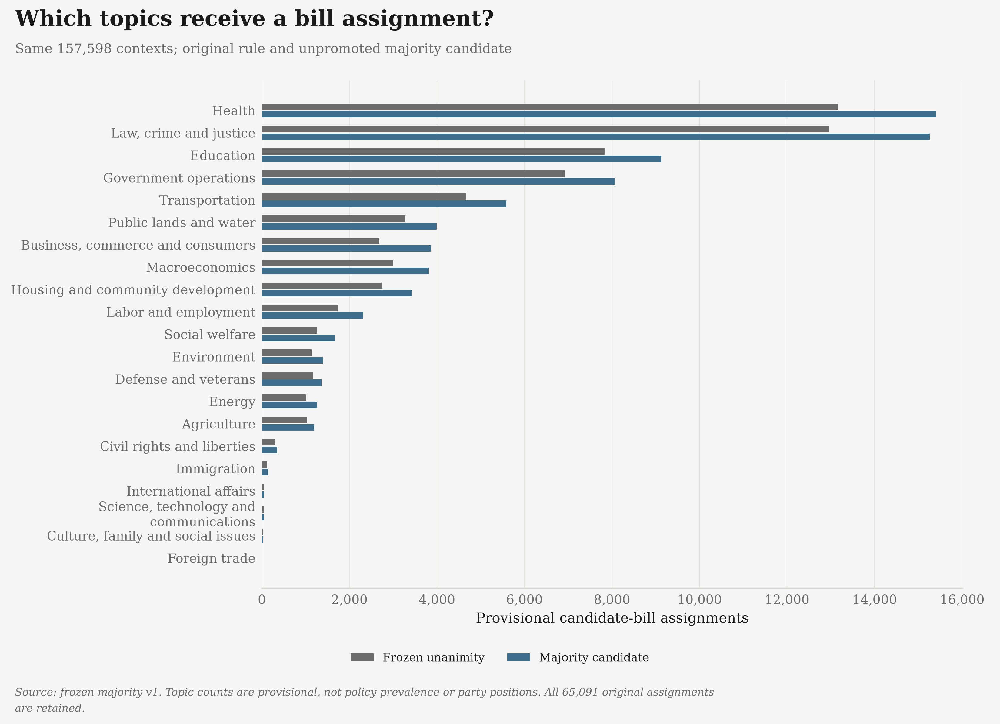

# Current state-politics graphs

**27 regenerated charts, 108 exports**, using the saved 2023-2024 evidence.
The original and majority classifications remain separate and provisional.
These are research graphics, not independently validated party-policy findings.
The [training-exposure census](../docs/REPRODUCIBILITY.md#population-training-exposure-census)
finds 65 exact training-input matches and 610 training-seen bill identities.
Population counts are not a held-out test; an unmatched record does not establish
independence. That warning now travels with the topic-comparison PNG/SVGs and
appears in the gallery, not only in the main project README.

The current source union has **139,869 contexts with text / 17,729 gaps**.
Unanimity assigns 65,306 contexts and abstains on 74,563; the separate,
unpromoted majority candidate assigns 78,522. The seven latest recovered bill
contexts add one assignment and six abstentions without changing earlier
decisions. Their reader differences are limited to nine independently proved
PDF hyphen positions; neither raw string is normalized. Source versions remain
explicitly **enacted laws, not introduced texts**; original dates are unchanged.

| Destination | Background | Files |
|---|---|---|
| [Substack](substack/) | Warm cream `#F7F5F0` | 300-dpi PNG and editable SVG |
| [The Margin of Error](themarginoferror/) | Page grey `#F5F5F5` | 300-dpi PNG and editable SVG |

Both folders contain `majority/`, `topics/`, `evidence/`, `scores/`, `inputs/`
and `context/`. They use identical data and geometry, not recolored screenshots.
The paired topic comparison includes aligned exact unanimity/majority counts,
including zeros, so low-count topics remain readable on the shared linear scale.
This presentation update changes no classifications or source coverage.
The recovered-text chart now labels every state's exact cohort total, including
Massachusetts's single context and Maine's empty cohort. Its caption distinguishes
50 accounted states from 49 with cohort contexts, not actual legislative activity.
The three-panel bill-evidence chart uses matching state-row positions and exact
counts, including tiny values and observed zeros; unknown native-text channels
remain labelled "not supplied". These overlapping metadata channels must not
be added or mistaken for the final recovered-text totals.
The session/calendar comparison also has aligned exact overlap/session-only
counts for its three supplied scopes; the other 47 states remain unsupplied,
not inferred zeros.
Open [`index.html`](index.html) locally to browse every chart and download.
[All 35 complete chart tables](chart-data/),
[the full chart-data ZIP](current-chart-data.zip) and
[provenance/file hashes](current-graphs-manifest.json) accompany the graphics.

## Legacy and original evidence

An additional [consumed-diagnostic exposure graph](../docs/REPRODUCIBILITY.md#consumed-bill-diagnostic-exposure)
separates the original 617 training/dev matched contexts from 229 additional
bill identities in two actually evaluated development sets. Its local
cream/grey PNG/editable SVGs, all 50 state rows, 846 context joins and 229
complete original reference/prediction pairs are in
`data/consumed-diagnostic-exposure-20261030-v1/`. The union includes 93 missing
bodies; bill-identity matches do not establish the same version/input or
training leakage. These extra research exports do not alter the canonical
27-chart collection or supply independent accuracy.

A separate [local exposure-sensitivity diagnostic](../docs/REPRODUCIBILITY.md#saved-label-exposure-sensitivity)
compares the same saved decisions after removing observed train/dev matches.
Its additional cream/grey PNG/editable-SVG exports, complete topic/status/state
tables and all removed decision records are under
`data/saved-label-exposure-sensitivity-20261029-v2/`. They are local/ignored,
not part of this canonical 27-chart collection or an independently held-out test.
No existing figure, table, ZIP, prediction or cohort membership changes.
The national and state-local share-change diagnostics remove only that
original 617-context match set, not the additional consumed-diagnostic identities.

The [state-local extension](../docs/REPRODUCIBILITY.md#state-local-exposure-sensitivity)
shows why the small national maximum is not a bound for individual states.
Pennsylvania changes by up to 1.79 / 4.55 percentage points under unanimity /
majority when its diagnostic subset shrinks from 56 to 44 contexts. Actual
cream/grey PNG/editable SVGs and all 2,100 state/topic, 1,200 state/status and
100 state/rule peak rows are in `data/state-exposure-sensitivity-20261029-v1/`.
State labels show full/remaining counts; Maine stays unavailable, not zero
activity. These additional local diagnostics are not independent validation,
canonical-cohort changes or website publication.

The thirteen PNGs directly in this directory are **unchanged legacy references**,
not the current graph collection. Do not treat their older party/platform
comparisons as revalidated findings.

Versioned research bundles remain local and unchanged; they contain the complete
original policy texts, predictions and source alternatives. Those large archives
are not supplied by cloning GitHub and are not replaced by chart-data exports.
See the [reproducibility guide](../docs/REPRODUCIBILITY.md#current-dual-background-graph-collection)
for sources, a fresh replay command and the distinction between source completion
and scientific validation. Nothing has been deployed to themarginoferror.com.
